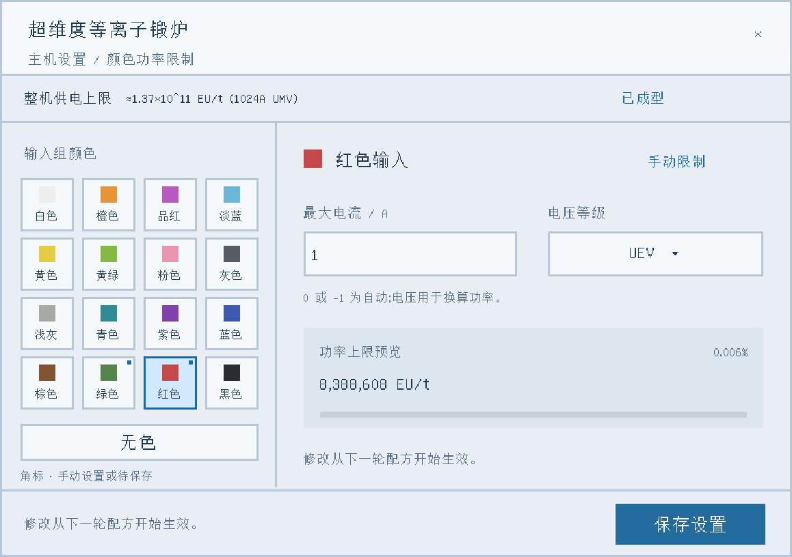

# Plasma Forge Power · Fusion support

[中文](README.md) · **Minecraft 1.7.10 / GTNH 2.9.0-RC-2**

Implemented by GPT-6 (Codex). Adds a blue-and-white settings panel to the existing **Dimensionally Transcendent Plasma Forge and ordinary / compact fusion controllers**, with a separate power budget for every input color and unpainted inputs. Energy hatches remain a common supply.

<p align="center"><strong>One forge. Separate power budgets for each input color.</strong><br>17 input groups · Native UI · Configuration copying · Supply-aware limits</p>

<p align="center">
  <a href="https://github.com/arturia-Xayah/gtnh-plasma-forge-power/releases/tag/v0.2.0-alpha-GTNH-2.9.0-RC-2"></a>
  
  
  <a href="https://github.com/arturia-Xayah/gtnh-plasma-forge-power/actions/workflows/build.yml"></a>
</p>

<p align="center"><a href="https://github.com/arturia-Xayah/gtnh-plasma-forge-power/releases/tag/v0.2.0-alpha-GTNH-2.9.0-RC-2">Download JAR</a> · <a href="README.md">中文</a> · <a href="VERIFICATION.md">Verification</a></p>



> Offline preview reconstructed from the current UI layout. In-game fonts and scaling follow the client configuration.

## Usage

1. Install `plasmaforgepower-0.2.0-alpha-GTNH-2.9.0-RC-2.jar` in `mods`. Servers and clients must use the same version.
2. Open the forge or fusion controller and click the blue **P** button on its right.
3. Select the paint color of the input bus, fluid hatch or crafting input hatch.
4. Enter amperage, choose **ULV–MAX**, then save.

**0 and -1 mean automatic.** Positive fractional amperage is supported and converted conservatively to whole EU/t. Voltage is a unit for expressing the budget; it does not transform the physical supply voltage. A budget is a ceiling, not a guaranteed consumption rate.

With a 1024A UMV supply, for example, red can use a 1A UEV budget, green a 16A UMV budget, and unpainted inputs can stay automatic. The forge still runs its normal recipe operation rather than independent simultaneous colored jobs.

The supply header also shows equivalent amperage and voltage, for example `≈1.37×10^11 EU/t (1024A UMV)`. Amperage is calculated from total power and the native average input voltage; nonintegral results are approximate.

Supply values of at least 1 billion EU/t use scientific notation with three significant figures. Hover over the header for the exact EU/t; calculations keep full precision.

## Behavior

- Recipe eligibility, overclocking, applicable parallels and convergence catalyst adjustments use the selected group's budget.
- Edits affect the next recipe. The current recipe retains its calculated consumption and duration.
- Saving or a successful structure check permanently lowers manual budgets above the rated supply. Replacing the supply with a larger one does not raise them again.
- Incomplete structures retain settings until successful formation. Automatic groups retain automatic mode.
- Automatic mode preserves native processing rules, including the single-normal-energy-hatch rule. No extra supply capacity is granted.
- If every group is automatic, the original recipe-search implementation runs unchanged.

For the plasma forge, painted groups may use native shared unpainted ingredients. With manual settings, complete unpainted recipes are considered first, then complete painted recipes, then painted recipes requiring shared ingredients. An empty painted hatch cannot bypass a complete unpainted recipe's power limit. Bus input separation is respected.

All internal recipe inventories of a crafting input hatch use that physical hatch's color.

## Copying and persistence

Settings integrate with Matter Manipulator's GT `IDataCopyable` capture/apply path and the native Data Orb multiblock configuration operation. Left-click the controller with the Data Orb to save, then right-click the target controller to paste.

All 17 groups are copied. Inventory contents, stored energy and progress are excluded. A formed destination immediately clamps oversized budgets; an incomplete destination keeps the copied values until formation. World saves and restarts preserve settings.

## Compatibility and removal

Target: **GTNH 2.9.0-RC-2 / GregTech 5.09.54.205 / ModularUI 2.3.92 / UniMixins 0.3.1**. Dependencies are supplied by the pack, not bundled. Other GT versions require patch-location verification.

No blocks or items are registered. To remove the add-on, finish the active recipe, disable the forge, save and close the game/server, then remove the add-on from both sides. The original controller and structure remain; power calculations revert to vanilla GT. Extra settings may be discarded by subsequent saves without the add-on.

Dedicated-server tests cover real formation, recipes, tick execution, ingredient protection, supply replacement, Matter Manipulator, Data Orbs, restart and removal. No game client was launched; client rendering and mouse interaction have not been checked in-game. See [VERIFICATION.md](VERIFICATION.md).

## Build

Run Gradle with JDK 25 and provide a Java 8 toolchain for Minecraft compilation:

```sh
./gradlew build
```

Install `build/libs/plasmaforgepower-0.2.0-alpha.jar`, not the development or sources classifier. Distribution filenames also identify the target GTNH version.

Full-pack fixtures are opt-in with `-PforgePowerTests=true` and excluded from normal builds. See [TESTING.md](TESTING.md).

LGPL-3.0-or-later. See [THIRD_PARTY_NOTICES.md](THIRD_PARTY_NOTICES.md).


## Fusion support (0.2.0)

Version 0.2.0 adds ordinary Fusion Mk-I–V and Compact Fusion Mk-I–V, sharing the native **P** configuration panel and ULV–MAX voltage units. Fusion limits use the native processing ceiling; charging rate, energy storage, startup eligibility/tax and hot handoff stay native.

Only power is limited. Native recipe traversal and caching remain in control; there is no order-priority scheduler. Continuous idle ingredients may therefore keep the idle recipe selected until existing input automation changes that. A cap below base recipe EU/t rejects the candidate instead of underclocking it below its base usage. Configuration edits take effect on the next reaction. See [Fusion usage](docs/FUSION.md) and [verification](VERIFICATION.md).
